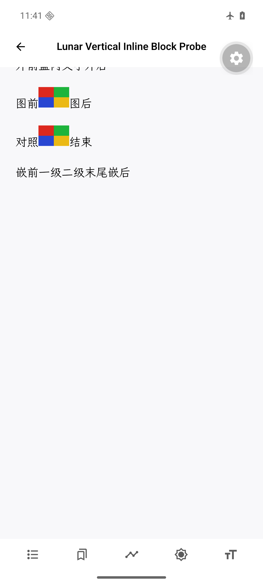
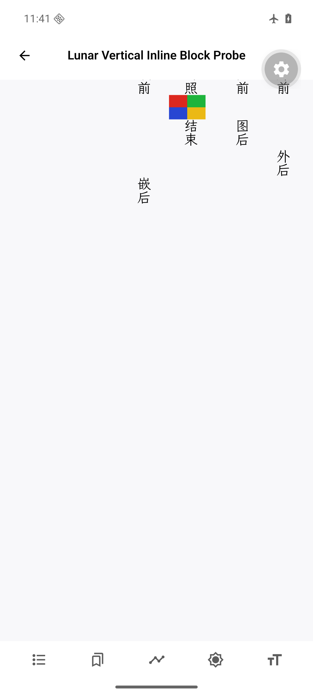

# 竖排 inline-block 的文字与图片未绘制

这是独立的Rito绘制缺陷。内联块已经参与排版、占据空间，其内容也进入文本索引；竖排绘制却跳过了整个子树，造成看不见的文字和图片。它与已有[竖排交互坐标问题 #43](https://github.com/Ringyuki/Rito/issues/43)不同。

修复提交：`dbef76cdf15dabd48bb83d03f3c2ddf82b263b9e`，分支 `fix/vertical-inline-block-paint`，基于刚核对的上游 `dev@ed0284f3703244da28b3e6efd80cf29267cf6e65`。仅修改竖排绘制遍历及内联回归，没有包含搜索、表格、浮动或交互坐标修复。

## 从真实样书缩小复现

公开《草枕》竖排控制版 `samples/kusamakura-vertical-only.epub`：SHA-256 `5eee439293bd53cb2c284a9b988e8e15013aa433a415d10427fbf7bd1bc62a0d`，来源和许可沿用[证据分支说明](../../README.md)。仅移除了未启用的备用样式引用，未修改封面正文或图片。源文件 `OPS/xhtml/表紙.xhtml` 有两张图片：Logo位于 `span.block` 中，`.block { display:inline-block; height:4em }`，图片 `height:100%`；另一张为作者人像。

实测完整走完封面直到下一spine文件：第0页完全没有内容绘制，第1页有书名和作者，第2页才有人像，第3页进入目录。人像由原生资源加载，45246字节，SHA `5c1fc816a173879caf09d181c86b2f61235e61f2dab3feaebc3122ae67fb1d32` 与源图相同；三页封面均没有Logo资源或绘制命令。因此不能把首屏无图笼统称为所有图片都丢了。见 `pages.json`、`cover-first-page.png`。

再用原创CC0 [对照书](../../samples/vertical-inline-block-probe.epub)隔离条件：[生成器](../../scripts/vertical-inline-block-probe.py)只使用标准库生成四色PNG和三个正文相同的章节，分别为横排、标准竖排和EPUB前缀竖排。正文含普通文字、盒内文字、嵌套内联块、盒内图片及直接图片。EPUBCheck5.4.0报告0错误、0警告，见 `probe-epubcheck.json`。

| 检查 | 横排 | 两种竖排，当前APK | 两种竖排，修复后的dev原生API |
|---|---|---|---|
| 盒内文字及嵌套文字 | 可见 | 不绘制 | 恢复绘制 |
| 页文本索引中的盒内文字 | 存在 | 仍存在 | 与基线完全相同 |
| 同页两张图片 | 2张 | 1张，盒内图片消失 | 2张 |

通过Lunar公开运行时搜索API查询“盒内文字”，能定位到竖排章节的源范围，但当前APK画面不显示这段字，见 `invisible-text-search.json`。这不是搜索界面验收，也说明仅检查搜索、索引和导入成功不足以证明没有丢失可见内容。





## 版本与修复验证

设备：API36、1080×2400、420dpi、4GiB、x86_64系统经ARM64兼容层运行开发APK。APK SHA为 `3fff66355689b9dd4d753bbee78452d89d2ea2ac6e19d4bcd3d569001600be2c`，Lunar JS为 `620a00fa531688fdc7277eef6a7afe3f475349b0`，`@umbrae-labs/rito-rn@0.3.0-lunar.1`、内核 `9c9111ca2fc57f63ce81c65d3c4f80cb513610ae`。JS导入性能分支没有修改Rito或绘制转换。只通过临时运行时句柄读取实际帧，不替换布局、绘制或资源。

同一本CC0书在上游dev的生产ReaderSession API中也复现。源码 `fragment_paint/vertical.rs` 只处理Image和Text子片段，直接跳过Box；横排绘制则递归处理Box的内部Line。修复按同样职责递归绘制内部行，先累加逻辑坐标，再使用原有竖排投影，沿用文字、图片、Ruby和链接的绘制路径。没有修改排版计算或文本索引，也没有新增协议字段。

Linux x86_64 / WSL、Rust1.95.0的基线/修复对照：

- 三章的页文本完全相同，横排完整绘制列表SHA也完全相同。
- 两种竖排均恢复“盒内文字”和多层嵌套文字，图片1→2；两张图的绘制矩形均在411×914视口内。
- 原《草枕》首屏Logo绘制命令0→1，源路径为 `../images/書デジ.png`；这是恢复可见内容，未宣称其尺寸已正确。
- 四项新增回归在未修改的dev生产代码上全部失败；修复后通过，覆盖阅读顺序、链接/替代文本、非对称图片物理方向、多层嵌套及改字号/视口后内容完整性。标准和EPUB前缀模式均覆盖。
- fmt、Clippy（workspace/all-targets，拒绝warnings）、全量测试通过：1020通过、8忽略。`checks.log` 为完整日志，`baseline-regressions.log` 为最终四项负向回归。

两个检出均使用Git原始LF字节；切换检出前清理整个workspace，避免共用Cargo target复用其他分支产物。1553个最终源码文件与Git提交逐字节核对，基线仅叠加同一份新测试及模块声明、生产文件保持不变。原生探针保存为不同可执行文件，源码与二进制身份见 `build.json`。

原始结果为 `probe-device.json`、`dev-{base,fixed}-native.json`、`dev-{base,fixed}-kusamakura-native.json`。主机字体为同一SourceHanSerifCN，设备为WenKai，不能将两者字形坐标逐像素比较。ICU日语分词模型提示仍存在，不据此宣称完整日语分词或竖排支持。

## 仍待单独处理的尺寸问题

本修复只恢复原有排版片段的绘制，不改图片尺寸。对照书的盒内横图声明48×32，恢复绘制后仍被计算为32×21.328125，而直接图片为48×32。另一个30×20的窄控制在Chrome155中，盒内/直接图片均为30×20；Rito盒内图片为20×13.328125。见 `landscape-browser-reference.html/.json`、`landscape-layout-diagnostic.log` 和修复后的原生图像矩形。

它涉及竖排内联块固有尺寸及图片宽高约束，独立保留复现。绘制回归中的20×30纵图用于隔离物理方向与元数据传递；没有以其通过掩盖横图缩小的问题。《草枕》Logo恢复后为250×250，百分比高度与容器尺寸也需要进一步核对。**图文重新可见不等于完整还原源CSS。**

本报告不声称解决#43的命中坐标、所有混合书写模式、内联块装饰或图片尺寸计算。当前Android安装包没有采用修复；没有更新适配器/锁文件、发布npm包或合并PR。

## 复现

1. 按 `vertical-inline-block-probe.py` 生成或直接使用提交的CC0 EPUB，用EPUBCheck校验。在同一开发APK中导入，分别打开三章，观察盒内文字和图片；书内无脚本、字体或备用样式。
2. 启动Lunar Metro、安装相同APK、`adb reverse tcp:8081 tcp:8081`。`kusamakura-image-install.js` 只打开指定公开《草枕》并暴露运行时；随后运行 `kusamakura-image-pages.js` 记录整个封面。对照书在实际导入服务中导入并导航，原始请求及bookId见 `probe-install.json`，运行时已捕获且书名匹配时执行 `vertical-inline-block-device.js`。
3. Linux中从上述精确提交分别 `git -c core.autocrlf=false archive` 导出两个一次性目录，准备Rust1.95.0，执行：

```sh
bash /evidence/scripts/check-vertical-inline-block.sh /base-export /fixed-export /output
```

该脚本仅向基线加入两份测试文件，确认4失败后，清理workspace并完成修复检查与原生探针构建。不要将验证example加入代码PR。

4. 用同一dev版本的primitive decoder读取探针结果；首个参数可为Lunar根目录（含可选的rito-rn开发检出）或Rito根目录。Windows会经WSL执行Linux探针，Linux直接执行：

```sh
node /evidence/scripts/vertical-inline-block-native.mjs . base /output/base-probe /linux/SourceHanSerifCN-Regular.otf
node /evidence/scripts/vertical-inline-block-native.mjs . fixed /output/fixed-probe /linux/SourceHanSerifCN-Regular.otf
# 添加 --kusamakura 重放公开原书封面。
python /evidence/scripts/analyze-vertical-inline-block.py
```

控制器使用生产ReaderSession API及匹配的上游primitive decoder，几何没有替换或模拟。材料与样书只在独立证据分支；代码分支只有绘制实现和内联单元测试。用户提供的三本书、截图和正文没有上传。
