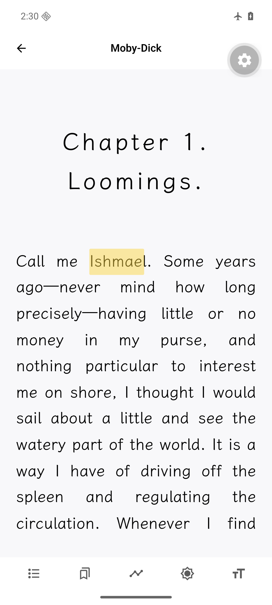

# 同书重排复用原生会话与宿主资源

对应 [Lunar #14](https://github.com/Umbrae-Labs/lunar/issues/14)。独立分支 `perf/reader-session-reflow`，基线 `main@4641589621f24d0df7d5a0811a3e26b1856c64cf`，代码 `15efd33e545716707abbd2beb03f88580dc6a26d`。只改阅读内核的三份实现／契约和一份测试；本报告、样书、脚本与截图只在 evidence 分支。

**改善的是已经打开同一本书后调整字号等布局的等待。** 原来每次重排都会重读完整 EPUB、重新创建原生会话及宿主字体／图片资源；现在相同字体身份时保留这些资源，按新布局请求候选工件，准备成功后通过原生比较并交换采用。首次打开、字体资源变化、换书和不支持复用的后端仍走完整加载。

## 生命周期与兼容边界

- 重排进入运行时的串行操作队列，并在 publication 队列中排在已运行的后台分页之后。未采用的候选不覆盖旧可见帧，失败释放候选；原生交接成功后更新 publication 的布局视图及私有槽位，再释放旧工件。工件本身不被修改。
- 连续布局操作通过 operation／AbortSignal 淘汰旧请求。若原生采用已经在途，先完成一致的内部交接，再由运行时拒绝旧 ready 快照，供下一操作继续。打开、关闭和前台导航也共用队列，避免较早关闭清掉新书状态。
- 保留原生 session、字体注册、文字测量器和有界图片缓存；重排清空旧修订画面缓存。书内字体的注册身份跨重排保留，避免重复传输同一字体。旧原生工件按已有上限释放，不累积整书工件。
- 字体角色、选择身份、已解析字体 SHA／长度参与资源身份。解析器重建同内容字节数组仍可复用；内容／字体选择改变，或字节没有可信 SHA 时完整重新打开。没有缓存一份 EPUB 后仍偷偷重建全部资源。
- 本分支不包含其他 XML、原书样式、FXL、导入或 Rito 修复，未升级 SDK／引擎。关闭 Promise 的另一项问题由 [PR #13](https://github.com/Umbrae-Labs/lunar/pull/13) 单独处理；本次不宣称它已合并，也不替代那项关闭顺序验证。

## 实际环境与方法

同一[公开 development APK](https://github.com/Umbrae-Labs/lunar/releases/download/nightly-20261024-40115172807/lunar-develop.apk)，SHA-256 `3fff66355689b9dd4d753bbee78452d89d2ea2ac6e19d4bcd3d569001600be2c`，原生源码 `8ecf3336ad73b4b73d93d1ade2d3b3847c5e9170`。Expo SDK 57、RN 0.86.3、`rito-rn@0.3.0-lunar.1`、内核 `9c9111ca2fc57f63ce81c65d3c4f80cb513610ae`。仅切换 Metro 的 JS，没有在 Windows 编译 Android。

Android API 36 `handwrite-api36`，4 GiB、1080×2400、420dpi，x86_64／ARM64 转译。输入为原始公开 [moby-dick.epub](../../samples/moby-dick.epub)，SHA-256 `81bc079841a38e91a02a7776d04786a2fc311cfd300064e9fc533ce7c54cf7b4`，来源和 CC BY-SA 3.0／附属资源许可见[根说明](../../README.md)。没有用户私有 EPUB 或正文。

正式实验为三组基线／修复交替，共六次，每次 force-stop、切精确提交、冷启动应用，记录新 PID 和实际后端是否提供 reflow。统一 411×914 视口、2.625 像素比、文楷、1.65 行高，输入脚本与[关闭测试](../../scripts/reader-close-input.js)一致。

直接使用生产 Runtime、文件加载、Rito 后端及 Skia Picture 编译；包装只计数／计时，不替换实现。暂停该诊断会话的后台分页，无可见 Canvas；计时到 runtime ready，不含 React Hook 的排队、邻页预热、GPU 呈现或手指交互。**这是相同完整 runtime 重排范围的比较，区别于前面的裸 `requestArtifact` 可行性计时。** 没有同时运行编译或单元测试。顺序固定、每项每版本只有三次，开发模拟器不代表生产真机。

## 完整重排结果

每次进程内从 18px 起，依次改为 20、22、18px；下表为每个字号三次的中位数，毫秒。

| 操作 | 基线 | 修复 |
|---|---:|---:|
| 20px 重排 | 1331.91 | 550.92 |
| 22px 重排 | 880.86 | 196.65 |
| 18px 重排 | 512.54 | 130.45 |
| 含图片封面的 20px 重排 | 658.70 | 35.58 |

三次文字重排完成时，基线每个进程累计 **4 次整包读取／4 次 backend.open**（含首次打开），修复均为 **1 次读取／1 次打开、3 次 reflow**。修复的 session、字体注册器、图片缓存均与初始对象相同；每次完成后 SDK 活工件数为 1。它们证明这条路径减少了重复工作，不能据此宣称降低整机峰值内存或解决泄漏。

源码分支实际 `backend.open` 每次均调用 `RitoReaderSession.open`；计数位于这个生产入口。脚本的 `disposes` 字段仅包装初始会话及四次显式对照打开，不包括基线重排内部创建的其他会话，**不能把该字段当作全部创建／释放数量或泄漏统计**。

首次打开和跨章节没有得到稳定提速证据：主实验首次打开中位数 **2981.79 → 4690.60ms，修复组更慢**；随后另做六次冷启动的分阶段检查，得到 **2262.25 → 2173.40ms**，没有稳定重现相同方向的差异。补充基线首次读取一次达到 1678.92ms，其后两次约 35ms；波动分布在读取和资源准备阶段，不能武断归因于某个因素，也不能据这些样本排除正式环境中的回归。分阶段的 `otherMs` 包含字体准备、调度等未单独包裹工作，不能当成纯字体耗时。见 [cold-profile/trials.json](cold-profile/trials.json)。

跨章节 next 和 previous 各两次／进程，六个 next 混合冷／暖路径的中位数 **63.04 → 69.45ms**，previous 为 **34.89 → 36.28ms**；不作跨章改善判断。具体顺序、每次耗时均在原始记录。本次未新增 RSS／JS 堆采样，导入内存的既有实测见[导入报告](../performance-streaming-import/README.md)。

## 正确性与实际页面

1. 六个正式进程各检查 20／22／18px 三个字号，并各用完整重新打开作对照。每个检查点的页文字、原生 DisplayList semanticDigest、源范围 `Ishmael` 的选文和非空矩形均一致；三组基线／修复相互比较也一致。
2. 封面在改字号前、改字号后、完整重新打开后均有实际图片指令和非空字节。修复／基线／重新打开的图片 SHA、长度及绘制语义一致，未只检查“资源文件存在”。
3. 精确跳到第一章末页，next／previous 两次往返实际经过第 2／第 1 章；没有通过目录跳转冒充跨章翻页。
4. 在实际书库打开这本公开书，用生产 store 的 `updateTypography` 触发阅读 Hook，检查 18→24→20→18px。后台分页和正常页面逻辑保持运行；原生 session 不变，持久化黄色高亮覆盖正确单词，恢复 18px 后几何与原位置相同。此步骤不是性能计时，也不等于验证所有选区拖动手势。
5. 另在实际页面比较 20px 复用重排与显式完整 reopen：Native session 确实改变，正文区域 `[0,310,1080,2200]` 的 PNG 像素完全相同（排除系统时钟、工具栏和页脚），包括已有高亮。截图保留原图，未裁剪、重绘或修饰。
6. 另选非首页的 `phantom` 源范围：18px 时位于零基第 5 页，24px 后移到第 10 页，仍为同一 session，选文和非空矩形正确。保存新位置、关闭并重新打开，恢复第 10 页，矩形与重排结果完全一致。见 [middle-position.json](middle-position.json)；避免只用首页标注支撑整项定位结论。

最初 UI 恢复在章内第 3 页，`Ishmael` 的源范围解析成功但在该页无矩形；这属于离屏标注，不是丢标注。原记录 [reflow-ui-before.json](ui/reflow-ui-before.json) 保留，随后明确跳到标注源位置才比较。没有把离屏结果算作通过，也没有改书修复它。



[20px 实际页面](ui/reflow-ui-20.png) · [同会话 20px](ui/reflow-ui-pixel-fast.png) · [完整 reopen 20px](ui/reflow-ui-pixel-fresh.png) · [像素核对](ui/reflow-ui-pixel-comparison.json)

这些结果不涵盖所有精排书、双页／竖排／RTL、全部页面、字体格式、DRM、完整读屏或长时间运行。当前安装包仍是旧内核，不能把另开的 Rito PR 当成此 APK 已有能力。

## 静态回归与设置恢复

相关 **32 项**通过，移动端 **87 文件、547 项**通过，TypeScript、修改源码 ESLint／Prettier 通过；代码提交的 hook 再次检查实现文件。最终测试文件复制到独立 main 检出，仅运行“字号复用”和“换字体回退”两项：**1 失败、1 通过、30 跳过**，与预期相符。该检出的生产代码未改，测试文件随后恢复；原有 Uniwind 声明差异保留。

单测还覆盖相同 SHA 的新字节数组、字体内容改变、候选采用失败、连续重排淘汰、原生采用中途被取代、关书取消、关闭后立即换书、后台量子与重排排序、嵌入字体仅注册一次。没有扩大测试超时。

原字体设置与字号恢复为 18px／原完整 typography，UI 返回书库；两轮冷启动的续读设置均恢复原值 true。见 `ui/*restored.json`、`settings-*.json` 和 `cold-profile/settings-*.json`。没有合并 PR、升级原生依赖或发布 SDK。

## 协作组复现

使用干净的专用 Lunar 检出，具有上述两个源码提交与 `perf/reader-session-reflow` 分支，依赖按锁文件安装。将本证据检出放在同级，目录名为 `lunar-epub-evidence`。控制器会切换源码提交并 force-stop 测试应用，不能在有未提交工作的检出中运行。

使用上述 APK／模拟器；只启动一个 Metro，从专用检出的 `apps/mobile`，设置 `APP_VARIANT=development`、`EXPO_NO_METRO_LAZY=1`，运行 `expo start --dev-client --offline --port 8081`，不启用 CI。应用先连接这个 Metro 并初始化设置 store。

从 Lunar 根目录执行，`/evidence` 代指证据检出的绝对路径，Windows 使用对应 PowerShell 路径：

```sh
adb reverse tcp:8081 tcp:8081
adb push /evidence/samples/moby-dick.epub /data/local/tmp/moby.epub
adb shell run-as com.lunarain_079.lunar.dev mkdir -p files/perf
adb shell run-as com.lunarain_079.lunar.dev cp /data/local/tmp/moby.epub files/perf/moby-dick.epub
adb shell run-as com.lunarain_079.lunar.dev sha256sum files/perf/moby-dick.epub
node /evidence/scripts/hermes-eval.mjs /evidence/scripts/reflow-prepare-settings.js
```

保存返回的原续读值。将 `scripts/reader-close-input.js` 复制到 Lunar 的 `.tmp/epub-validation/reader-perf-input.js`；把 `reflow-ready.js`、`reflow-runtime-check.js`、`reflow-cold-profile.js` 按同名复制到该目录。执行实际使用的控制器：

```sh
node /evidence/scripts/compare-reflow-runtime.mjs 15efd33e545716707abbd2beb03f88580dc6a26d
node /evidence/scripts/compare-reflow-cold.mjs 15efd33e545716707abbd2beb03f88580dc6a26d
```

正式及冷启动 JSON 写在 Lunar 的 `.tmp/epub-validation`，最后返回修复分支。观察超时先查 `__lunarAuditTask`，pending 时等原操作，不要重复打开。结束后用 `useApplicationSettingsStore.getState().setResumeReadingOnLaunch(保存的原值)` 恢复并读回确认；不要默认其他人的原值也为 true。

UI 复现需先将原始公开书导入书库，确认 bookId 为其 SHA。按顺序运行 `reflow-ui-open.js`、`reflow-ui-position.js`、`reflow-ui-adjust.js` 两次，然后 `reflow-ui-restore.js`；首次搜索源范围后明确定位，检查 sameSession、选文和矩形。已有黄色标注来自独立导入测试保存的公开 `Ishmael` 标注；新环境可通过正常选区 UI 建立同词标注。截图原生 `adb exec-out screencap -p`。像素对照另外按 `open → position → set20 → 截图 → fresh20 → 截图 → restore` 执行，比较上述区域；Python 的 Pillow 可复算，时钟等排除区不参与比较。

非首页检查在阅读器已关闭的进程中，先加载同一输入脚本，再用 Hermes 运行 `reflow-middle-position.js --async`；它搜索并定位公开书的 `phantom`，重排和重开后检查源范围，结束关闭自己的会话。这是位置与几何检查，不纳入耗时统计。

`scripts/verify-reader-session-reflow.py` 校核保存原始记录、源码／脚本指纹、六次正确性及 UI 几何／像素数据；它不能替代重新运行 Android。指纹清单和汇总见 [summary.json](summary.json)，未经提交的初次工作区实验只保留在 diagnostics，不参与正式统计。
